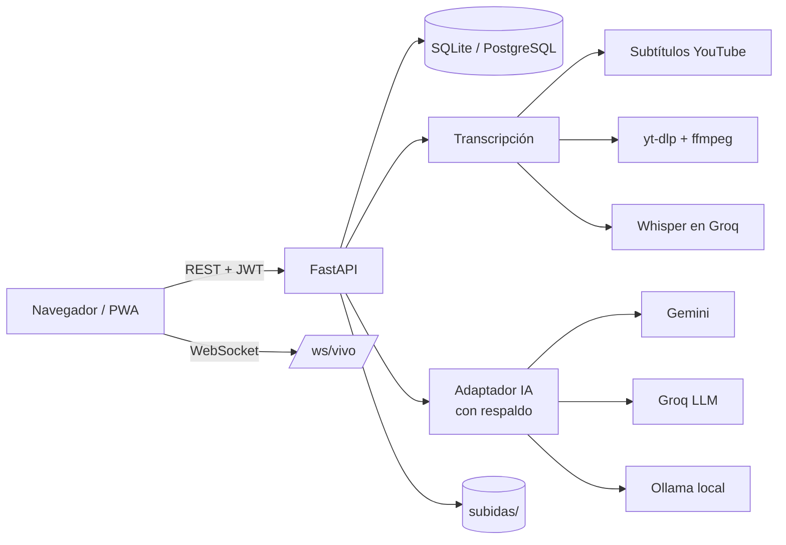

# Documentación completa del software

**Plataforma de Aprendizaje Activo con IA** · Repositorio `DevFajardo/plataforma-aprendizaje-ia`

Este es el índice maestro. Toda la documentación está en español y vive junto al código, así que cualquier cambio se versiona con él.

## 1. Mapa de documentación

| Documento | Para quién | Qué contiene |
|---|---|---|
| [README.md](../README.md) | Todo el mundo | Visión, funcionalidades, stack, instalación local, demo rápida, variables de entorno. |
| **Este archivo** | Todo el mundo | Índice, resumen ejecutivo, arquitectura exprés, roles, flujos, glosario e historial de versiones. |
| [MANUAL_USUARIO.md](MANUAL_USUARIO.md) | Estudiantes, docentes, coordinadores | Uso paso a paso de cada pantalla y rol. |
| [MANUAL_TECNICO.md](MANUAL_TECNICO.md) | Desarrollo | Arquitectura detallada, patrones de diseño, modelo entidad-relación, reglas de negocio, seguridad y pruebas. |
| [REFERENCIA_API.md](REFERENCIA_API.md) | Integradores y desarrollo | Los 102 endpoints agrupados por router, autenticación, permisos y convenciones de error. |
| [DESPLIEGUE.md](DESPLIEGUE.md) | Quien presenta / despliega | Demo local, LAN con `iniciar_demo.ps1`, túnel Cloudflare y nube gratuita (guía original). |
| [PLAN_PUBLICACION.md](PLAN_PUBLICACION.md) | Quien publica | **Plan recomendado de publicación 100 % gratuita**, límites vigentes, bloqueos de IA/transcripción y mitigaciones. |
| [OPERACION.md](OPERACION.md) | Quien mantiene | Troubleshooting, monitoreo, respaldos, rotación de claves y plan de contingencia. |
| [GUION_DEMO.md](GUION_DEMO.md) | Quien presenta | Guion de 8 minutos ante el jurado, plan B y preguntas probables. |
| [PROTOCOLO_EVALUACION.md](PROTOCOLO_EVALUACION.md) | Investigación | Diseño cuasi-experimental, SUS, retención y métricas. |
| [AUDITORIA_UX.md](AUDITORIA_UX.md) | Diseño / QA | Auditoría de interfaz y decisiones de UX. |
| `docs/capturas/` | Todo el mundo | Capturas en móvil, tablet y escritorio (claro y oscuro). |
| `docs/video/scripts/` | Producción | Guion de narración y scripts de grabación del video de demostración. |

## 2. Resumen ejecutivo

Aplicación web que convierte un video de **YouTube, Vimeo o un archivo subido** en **resumen, ideas clave y cuestionario** generados con IA, para aprendizaje activo. El estudiante responde con retroalimentación inmediata y marcas de tiempo; el docente publica, edita, mide resultados y dirige una clase en vivo; la coordinación ve logro por resultado de aprendizaje y alertas tempranas.

| Dimensión | Dato |
|---|---|
| Propósito | Herramienta académica universitaria (proyecto de grado), interfaz y docs en español |
| Frontend | Next.js 16 (App Router), React 19, TypeScript, Tailwind CSS v4, Montserrat, PWA |
| Backend | FastAPI, SQLAlchemy 2, Pydantic 2, JWT + bcrypt, 17 routers |
| Datos | SQLite local / PostgreSQL en producción; 23 modelos SQLAlchemy |
| IA | Gemini → Groq → Ollama (Strategy + Adapter con respaldo y reintentos) |
| Transcripción | Subtítulos de YouTube → audio con yt-dlp + ffmpeg → Whisper (Groq) |
| Tiempo real | WebSocket `/ws/vivo/{pin}` con respaldo HTTP para la clase en vivo |
| Pruebas | 320 pruebas pytest con BD temporal y mocks (sin red ni cuota de IA) |
| Tamaño | ~8.000 líneas backend, ~13.500 líneas frontend, ~3.400 líneas de pruebas |
| Estado | 9 sprints + cierre de demo; 13 commits; rama `main` |

## 3. Arquitectura en un minuto

Capas del backend: `routers/` (HTTP y permisos) → `services/` (reglas de negocio) → `modelos.py` (persistencia). La configuración centralizada está en `config.py`, la seguridad en `seguridad.py` y los esquemas de entrada/salida en `schemas_api.py`.

Detalle completo: [Manual técnico §1-4](MANUAL_TECNICO.md).

## 4. Roles y permisos

| Rol | Cómo se obtiene | Puede |
|---|---|---|
| **Estudiante** | Registro público | Generar cuestionarios, responder, historial, panel, unirse a cursos con código, encuesta SUS, tutor. |
| **Docente** | Registro público | Lo anterior + publicar/editar/duplicar cuestionarios, resultados y CSV, análisis de ítems, banco, grupos, alertas, clase en vivo, PDFs. |
| **Coordinador** | Lo asigna un admin (con `programa_id`) | Resumen institucional, logro por RA/Bloom/asignatura, tendencia, alertas y reporte PDF de su programa. |
| **Admin** | Lo asigna un admin | CRUD de facultades, programas, asignaturas, RA y usuarios; ve todos los grupos. |

Las dependencias `requiere_docente`, `requiere_rol`, `requiere_admin`, `requiere_coordinacion` y `requiere_seguimiento` centralizan la autorización (`backend/app/seguridad.py:67-86`). La propiedad de cada recurso se comprueba además en cada endpoint.

## 5. Flujos de negocio clave

1. **Generar** (`POST /api/procesar` o `/procesar/archivo`): se crea una `Tarea`, se devuelve su id y `BackgroundTasks` transcribe y llama a la IA. El frontend hace *polling* cada 2 s y al terminar abre `/cuestionarios/{id}`. Las tareas huérfanas se marcan `error` al arrancar.
2. **Responder** (`/api/intentos/...`): la calificación ocurre **en el servidor**. El tipo de intento es `inicial`, `practica` o `diferido`. El repaso diferido oculta la retroalimentación por pregunta y mide retención = diferido / inicial × 100.
3. **Clase en vivo** (`/api/cuestionarios/{id}/vivo` + `/ws/vivo/{pin}`): estado en memoria con persistencia en BD, PIN de 6 dígitos, temporizador del servidor, ranking y podio. Máximo 200 participantes. **Requiere un solo proceso** de uvicorn.
4. **Medición**: ganancia (primer vs. último intento), retención, SUS, d de Cohen entre grupo experimental y control, análisis de ítems (dificultad, discriminación, punto-biserial, distractores) y ahorro de tiempo docente.
5. **Datos personales**: registro con consentimiento obligatorio (Ley 1581 de 2012), consentimiento de investigación opcional, derechos de acceso/rectificación/supresión en `/cuenta`.

## 6. Convenciones

- Idioma de interfaz, comentarios, mensajes de error y documentación: **español**.
- Fechas: la BD guarda UTC; `FechaUTC` las serializa ISO 8601 con `Z`; el navegador formatea con `es-CO`.
- El token JWT se guarda en `localStorage` (`token`) y se envía como `Authorization: Bearer <token>`.
- Marca de tiempo de video: `mm:ss` (validada con Pydantic).
- CSV: BOM UTF-8 y prefijo `'` en celdas que empiezan por `=`, `+`, `-` o `@` (anti-inyección de fórmulas).
- Secretos: `backend/.env`, `frontend/.env.local`, `*.db`, `subidas/` y `cookies_youtube.txt` están en `.gitignore`.

## 7. Glosario

| Término | Significado |
|---|---|
| **RA** | Resultado de aprendizaje; se asocia a preguntas y se mide con semáforo (≥70 verde, 50-69 amarillo, <50 rojo). |
| **Bloom** | Nivel cognitivo de la pregunta: recordar, comprender, aplicar, analizar, evaluar, crear. |
| **Repaso diferido** | Post-test programado a 1, 3, 7 o 14 días para medir retención. |
| **Grupo control** | Cuestionario duplicado sin resumen, pistas ni retroalimentación; permite comparación cuasi-experimental. |
| **d de Cohen** | Tamaño del efecto entre dos grupos: <0,2 trivial, <0,5 pequeño, <0,8 mediano, ≥0,8 grande. |
| **SUS** | System Usability Scale: 10 ítems, puntaje 0-100; >80,3 excelente. |
| **Análisis de ítems** | Psicometría clásica: dificultad `p`, discriminación `D` (grupos extremos del 27 %) y punto-biserial. |
| **PIN** | Código de 6 dígitos para entrar a una clase en vivo. |
| **Fallback** | Cambio automático a otro proveedor de IA ante error transitorio o cuota agotada. |

## 8. Historial de versiones (git)

| Commit | Hito |
|---|---|
| `edd050f` | Versión inicial completa (sprints 1-4: generación, cuestionarios, intentos, SUS). |
| `e518dad` | Sprint 6: estructura académica, roles, RA, coordinación, alertas y PDF. |
| `9a988c8` | Sprint 7: clase en vivo estilo Kahoot y notificaciones. |
| `a098ec0` | Sprint 8: tutor IA, abiertas, calidad, psicometría, banco y subtítulos. |
| `a857c42` | Sprint 9: PWA, tutorial, datos demo, LAN, calibración y despliegue. |
| `b492bc7` | Guion de la demostración ante el jurado. |
| `6dfb8c0` | Auditoría de interfaz y pulido UX/UI. |
| `db0ce44` … `1ad8ff7` | Contacto de ejemplo, panel de calidad, sesión robusta, resultados por estudiante. |
| `999dd5e` … `8900f8d` | Alineación de tablas y botón «Unirme al curso». |
| `eff0e4c` | Guion de narración y scripts de grabación del video de demostración. |

> Nota: el salto del `edd050f` al `e518dad` no omite el Sprint 5; sus cambios (retención, grupo control, comparación y privacidad) quedaron incluidos en la versión inicial y se documentan en `tests/test_sprint5.py`.

## 9. Cómo mantener esta documentación

- Si cambias un endpoint, actualiza [REFERENCIA_API.md](REFERENCIA_API.md) y la tabla de endpoints del [Manual técnico](MANUAL_TECNICO.md#5-referencia-de-endpoints).
- Si cambias una regla de negocio, actualiza el [Manual técnico](MANUAL_TECNICO.md) y, si afecta al usuario, el [Manual de usuario](MANUAL_USUARIO.md).
- Si cambias límites de proveedores o de plataformas de despliegue, actualiza [PLAN_PUBLICACION.md](PLAN_PUBLICACION.md) (incluye la fecha de verificación).
- Antes de cada demo, repasa el [checklist de operación](OPERACION.md#6-checklist-antes-de-publicar-o-presentar).
