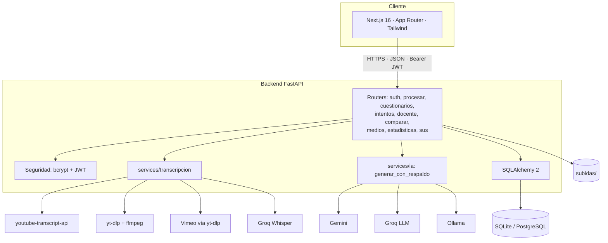
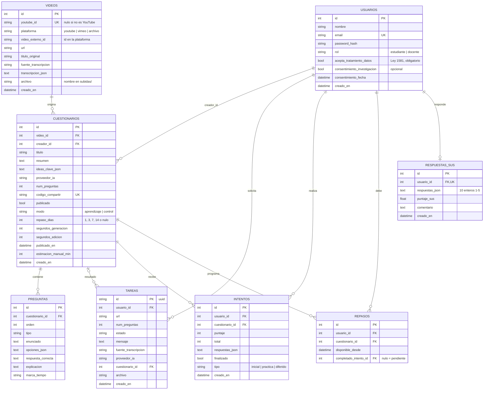

# Manual técnico

## 1. Arquitectura



- **Frontend** (`frontend/`): páginas en `src/app`, componentes en `src/components`, utilidades en `src/lib` (`api.ts` cliente HTTP, `auth.tsx` contexto de sesión, `fechas.ts` formato de fechas en hora local, `tipos.ts` tipos que reflejan `schemas_api.py`). El token JWT se guarda en `localStorage`.
- **Backend** (`backend/app`): una aplicación FastAPI con routers por dominio. El esquema `app/schemas.py` pertenece al adaptador de IA; `app/schemas_api.py` define la entrada/salida de la API.
- **Fechas**: la BD guarda UTC. Como SQLite devuelve datetimes sin zona, `schemas_api.FechaUTC` les asigna UTC al validarlos, de modo que siempre se serializan en ISO 8601 con `Z`. El navegador los formatea con `Intl.DateTimeFormat('es-CO')`.

## 2. Proveedor de IA: Strategy + Adapter con respaldo

`app/services/ia/base.py` define la interfaz `ProveedorIA` (`generar()` y `configurado()`) y el prompt común. Cada proveedor (`gemini.py`, `groq_llm.py`, `ollama.py`) es un **adaptador** que oculta su SDK y devuelve el mismo `ResultadoIA` validado por Pydantic. El resto de la aplicación depende solo de la abstracción (patrón **Strategy**).

`generar_con_respaldo(texto, num_preguntas)` (en `services/ia/__init__.py`):

1. Recorre los proveedores en el orden de `PROVEEDORES_IA`.
2. Omite los que no tienen clave (`configurado() == False`).
3. Ante errores **transitorios** (red, timeout, HTTP 429/5xx) reintenta con esperas de 2 s y 5 s (no para Ollama).
4. Si el proveedor sigue fallando, registra el error y **pasa al siguiente**.
5. Si todos fallan, lanza `RuntimeError` con el resumen de fallos, que se muestra al usuario.

Añadir un proveedor nuevo = crear una clase que implemente `ProveedorIA` y registrarla en `PROVEEDORES`.

El prompt exige responder **siempre en español**, aunque la transcripción esté en otro idioma. Whisper detecta el idioma automáticamente salvo que `IDIOMA_TRANSCRIPCION` esté definido.

## 3. Flujo de procesamiento

```mermaid
sequenceDiagram
    actor U as Usuario
    participant F as Frontend
    participant A as API (FastAPI)
    participant B as Tarea en segundo plano
    participant T as Transcripción
    participant I as IA (con respaldo)
    participant D as BD

    U->>F: Pega URL o sube archivo
    F->>A: POST /api/procesar (o /procesar/archivo)
    A->>D: Crea Tarea (pendiente)
    A-->>F: 200 TareaOut (id)
    A->>B: BackgroundTasks
    loop cada pocos segundos
        F->>A: GET /api/tareas/{id}
        A-->>F: estado + mensaje
    end
    B->>D: Estado = transcribiendo
    alt Video ya en caché
        B->>D: Reutiliza transcripción
    else YouTube
        B->>T: Subtítulos; si fallan, yt-dlp + Whisper
    else Vimeo
        B->>T: yt-dlp (audio) + Whisper
    else Archivo
        B->>T: ffmpeg (audio) + Whisper
    end
    B->>D: Estado = generando
    B->>I: generar_con_respaldo(transcripción)
    I-->>B: ResultadoIA + proveedor
    B->>D: Guarda Cuestionario y Preguntas, estado = listo
    F->>A: GET /api/cuestionarios/{id}
```

Las tareas huérfanas (servidor reiniciado a mitad) se marcan como `error` al arrancar.

**Plataformas.** `identificar_video(url)` devuelve `(plataforma, id)` con plataforma `youtube` o `vimeo` (acepta `vimeo.com/123`, `vimeo.com/channels/x/123`, `player.vimeo.com/video/123` y `vimeo.com/123/hash` para no listados). La caché de transcripción busca por `(plataforma, video_externo_id)`. `extraer_video_id` se conserva como envoltorio solo para YouTube. Vimeo no ofrece API de subtítulos: siempre se descarga el audio con yt-dlp y se transcribe con Whisper. Se descarga desde `player.vimeo.com/video/{id}` porque `vimeo.com/{id}` exige iniciar sesión en yt-dlp; los videos con protección DRM o privados fallan con un mensaje claro.

**Transmisiones en vivo y duración.** Antes de descargar audio, `_descargar_audio` llama a `extract_info(download=False)` y `verificar_video_procesable` rechaza `is_live` / `live_status` en (`is_live`, `is_upcoming`, `post_live`) y los videos con `duration` mayor que `MAX_DURACION_MIN` (por defecto 180 min). Si el video de YouTube tiene subtítulos no se hace esta consulta (no se descarga audio).

## 4. Modelo entidad-relación



Tablas: `usuarios`, `videos`, `cuestionarios`, `preguntas`, `tareas`, `intentos`, `repasos`, `respuestas_sus`.

Las tablas se crean con `Base.metadata.create_all`; las columnas añadidas después del Sprint 2 se migran con `_migrar_columnas()` en `db.py` (`ALTER TABLE ADD COLUMN` si faltan; la primera vez que se añade una columna también rellena los datos previos: `plataforma` y `video_externo_id` de los videos, `tipo` de los intentos —el primero finalizado de cada usuario por cuestionario es `inicial` y los demás `practica`— y `publicado_en` de los cuestionarios ya publicados). Las cuentas anteriores al Sprint 5 quedan con `acepta_tratamiento_datos = false` y se les pide aceptar la política en «Mi cuenta». Borrar un cuestionario elimina en cascada sus preguntas e intentos; si su video era un archivo subido y nadie más lo usa, también se elimina el archivo de `subidas/`.

## 5. Referencia de endpoints

Todos los endpoints (salvo los marcados «público») exigen la cabecera `Authorization: Bearer <token>`.

| Método | Ruta | Permisos | Descripción |
|---|---|---|---|
| GET | `/api/salud` | público | Estado del servicio y proveedores de IA configurados. |
| POST | `/api/auth/registro` | público | Crea una cuenta (rol estudiante/docente) y devuelve el token. Exige `acepta_tratamiento_datos: true` (422 si no); `consentimiento_investigacion` es opcional. 409 si el correo existe. |
| POST | `/api/auth/login` | público | Inicia sesión y devuelve el token. 401 si las credenciales son incorrectas. |
| GET | `/api/auth/yo` | autenticado | Datos del usuario actual (incluye los consentimientos). |
| PATCH | `/api/auth/cuenta` | autenticado | Edita nombre, contraseña (`password_actual` obligatoria; 400 si es incorrecta) y consentimientos (`consentimiento_investigacion`, `acepta_tratamiento_datos`). |
| GET | `/api/auth/mis-datos` | autenticado | Derecho de acceso: JSON con usuario, cuestionarios, intentos, repasos y encuesta. |
| DELETE | `/api/auth/cuenta` | autenticado | Derecho de supresión: cuerpo `{password}` (400 si es incorrecta); borra intentos, repasos, encuesta, tareas, cuestionarios propios con preguntas y archivos subidos. |
| POST | `/api/procesar` | autenticado | Procesa una URL de YouTube o Vimeo en segundo plano; devuelve la tarea. 400 URL inválida, 429 límite diario. Las transmisiones en vivo y los videos de más de `MAX_DURACION_MIN` terminan en `error` con un mensaje claro. |
| POST | `/api/procesar/archivo` | autenticado | Sube un video/audio (multipart: `archivo`, `num_preguntas`) y lo procesa. 400 formato, 413 tamaño. |
| GET | `/api/tareas/{id}` | dueño de la tarea | Estado de una tarea de procesamiento. |
| GET | `/api/cuestionarios` | autenticado | Cuestionarios propios y los ajenos publicados con intentos del usuario. |
| GET | `/api/cuestionarios/{id}` | creador o publicado | Detalle; las respuestas correctas solo se incluyen para el creador. |
| DELETE | `/api/cuestionarios/{id}` | creador | Elimina el cuestionario, sus intentos y, si procede, el archivo subido. |
| POST | `/api/cuestionarios/{id}/intentos` | creador o publicado | Inicia un intento y devuelve `tipo` (`inicial`, `practica` o `diferido`) y `con_feedback`. Es `diferido` si el usuario tiene un repaso vencido sin completar. |
| POST | `/api/intentos/{id}/responder` | dueño del intento | Califica una respuesta en el servidor y devuelve retroalimentación. En intentos diferidos y en el modo control devuelve solo `registrada` (`con_feedback: false`). 409 si ya se respondió o el intento terminó. |
| POST | `/api/intentos/{id}/finalizar` | dueño del intento | Calcula el puntaje final (excluye preguntas abiertas), fija el `tipo` definitivo, crea el repaso tras el intento inicial o lo marca como completado. En un diferido (modo aprendizaje) incluye `revision` con las respuestas correctas. |
| GET | `/api/intentos` | autenticado | Historial de intentos finalizados del usuario. |
| GET | `/api/repasos` | autenticado | Repasos pendientes del usuario: vencidos (`vencido: true`) y próximos con su fecha. |
| POST | `/api/cuestionarios/{id}/publicar` | docente creador | Publica o despublica; admite `estimacion_manual_min` opcional. Fija `publicado_en` la primera vez. |
| POST | `/api/cuestionarios/{id}/duplicar` | docente creador | `{modo, titulo?}`: copia con preguntas, código nuevo y estado borrador (p. ej. versión grupo control). |
| POST | `/api/cuestionarios/{id}/tiempo-edicion` | docente creador | `{segundos}` (1 a 14 400): suma el tiempo activo de una sesión de edición. |
| GET | `/api/compartido/{codigo}` | autenticado | Resuelve un código de 6 caracteres a un cuestionario publicado. |
| PATCH | `/api/cuestionarios/{id}` | docente creador | Edita título, resumen e ideas clave, y configura `repaso_dias` (1, 3, 7, 14 o `null`) y `estimacion_manual_min`. |
| PUT | `/api/preguntas/{id}` | docente creador | Edita una pregunta (validada; 422 si es inconsistente). |
| POST | `/api/cuestionarios/{id}/preguntas` | docente creador | Agrega una pregunta. |
| DELETE | `/api/preguntas/{id}` | docente creador | Elimina una pregunta y reordena. |
| POST | `/api/cuestionarios/{id}/reordenar` | docente creador | Reordena las preguntas con una lista de ids. |
| GET | `/api/cuestionarios/{id}/resultados` | docente creador | Intentos (con tipo y consentimiento), acierto por pregunta, respuestas abiertas, **ganancia de aprendizaje** y **retención**. |
| GET | `/api/cuestionarios/{id}/resultados.csv` | docente creador | Igual en CSV (BOM UTF-8, anti-inyección de fórmulas, secciones de ganancia y retención, columnas «Tipo de intento» y «Consentimiento investigación»). Incluye a todos los estudiantes del curso. |
| GET | `/api/comparar?a={id}&b={id}` | docente creador de ambos | n, media y desviación muestral por grupo del intento inicial, el diferido y la retención; diferencia de medias, d de Cohen e interpretación. 400 si `a == b`. |
| GET | `/api/comparar.csv?a={id}&b={id}` | docente creador de ambos | Datos por estudiante (`E1..En`, inicial, diferido, retención) **solo de quienes aceptaron participar en la investigación**. |
| GET | `/api/medios/{nombre}` | público | Sirve un archivo subido (con `Range`). El nombre debe ser `uuid-hex.extensión`; 400 si no. |
| GET | `/api/estadisticas/yo` | autenticado | Métricas personales (incluye `retencion_promedio`); si es docente añade el bloque `docente` con el ahorro de tiempo. |
| POST | `/api/sus` | autenticado | Guarda (o actualiza) la respuesta SUS: `respuestas` (10 enteros 1–5) y `comentario` opcional. |
| GET | `/api/sus/mia` | autenticado | Tu respuesta SUS; 404 si no has respondido. |
| GET | `/api/sus/resumen` | docente | n, promedio, desviación estándar muestral, mín., máx., distribución por interpretación y promedio por ítem. |
| GET | `/api/sus/resumen.csv` | docente | CSV anónimo (id secuencial, rol, 10 respuestas, puntaje, comentario, fecha) **solo de usuarios con consentimiento de investigación**. |

### Cálculo SUS

Ítems impares (1, 3, 5, 7, 9) aportan `r − 1`; pares (2, 4, 6, 8, 10) aportan `5 − r`. La suma (0–40) se multiplica por 2,5. Interpretación: `< 51` Pobre · `51–68` Aceptable bajo · `68–80,3` Bueno · `> 80,3` Excelente. Implementado en `app/services/sus.py`.

### Ganancia de aprendizaje

Por cada estudiante con ≥ 2 intentos finalizados en el cuestionario se toma el porcentaje del primer y del último intento (ordenados por fecha). Se reporta el promedio de ambos y la diferencia en puntos porcentuales (medida pre-test/post-test).

### Repaso diferido y retención

Mide la **retención** del aprendizaje (post-test diferido).

- El docente fija `repaso_dias` (1, 3, 7 o 14) en el cuestionario. Cada intento tiene un `tipo`: `inicial`, `practica` o `diferido`.
- Al **finalizar** el primer intento (no diferido) de un estudiante, ese intento queda como `inicial` y, si hay `repaso_dias`, se crea un `Repaso` con `disponible_desde = ahora + repaso_dias`. Los siguientes intentos son `practica`. El **creador** del cuestionario no recibe repasos (sus intentos son pruebas).
- Al **crear** un intento, si el usuario tiene un `Repaso` vencido sin completar, el intento es `diferido`. Mientras ese repaso no se complete, cualquier intento nuevo es diferido.
- En un intento diferido el endpoint `responder` devuelve solo `{registrada: true, con_feedback: false}`; al finalizar, la respuesta incluye `revision` con las respuestas correctas y el `Repaso` queda completado (`completado_intento_id`).
- **Retención** de un estudiante = % del diferido / % del inicial × 100 (no se define si el inicial fue 0 %). En los resultados del docente: promedio inicial, promedio diferido, `retencion_pct` = promedio diferido / promedio inicial × 100 y la diferencia en puntos. La **ganancia de aprendizaje** ignora los intentos diferidos.

### Modo grupo control (diseño cuasi-experimental)

`Cuestionario.modo` es `aprendizaje` (por defecto) o `control`. En un cuestionario de control el servidor entrega a los estudiantes `resumen = ""`, `ideas_clave = []` y sin marcas de tiempo; `responder` nunca da retroalimentación y `finalizar` devuelve solo el puntaje (sin `revision`, ni siquiera en el diferido). El docente crea la versión de control con `POST /api/cuestionarios/{id}/duplicar`.

### Comparación de grupos

`GET /api/comparar` toma, por estudiante (sin contar al creador), el intento inicial y el diferido más antiguos, y calcula por grupo `n`, media y desviación estándar **muestral** (n − 1; nula con n < 2) de: inicial, diferido y retención. La diferencia de medias es A − B. La **d de Cohen** usa la desviación combinada, `sp = √(((n₁−1)s₁² + (n₂−1)s₂²) / (n₁+n₂−2))` y `d = (m_A − m_B) / sp`; se interpreta por |d|: < 0,2 trivial, < 0,5 pequeño, < 0,8 mediano, ≥ 0,8 grande. No es una prueba de hipótesis: la respuesta recuerda usar la prueba t de Welch en JASP/Excel con el CSV. Código en `app/services/estadistica.py`.

### Tiempo del docente

`segundos_generacion` se guarda cuando la tarea llega a `listo` (tiempo desde que se creó la tarea). El editor mide el **tiempo activo** (solo con la pestaña visible) y lo envía a `POST /tiempo-edicion` al guardar, cancelar, salir y cada 5 min. Para los cuestionarios con `estimacion_manual_min`: tiempo con la herramienta = `segundos_generacion + segundos_edicion`; ahorro % = (manual − herramienta) / manual × 100, calculado con los promedios (`estadisticas/yo` → `docente.tiempo`). Las copias creadas con «duplicar» parten de 0 s y sin estimación.

## 6. Seguridad

- **Contraseñas**: bcrypt con sal por contraseña (se limita a 72 bytes, el máximo de bcrypt).
- **Sesión**: JWT HS256 firmado con `SECRET_KEY`, con expiración (`TOKEN_EXPIRA_HORAS`). Si falta la clave, el servidor se niega a emitir tokens.
- **Autorización**: dependencias `usuario_actual` y `requiere_docente`; comprobación de propiedad en cada recurso (cuestionario, pregunta, intento, tarea).
- **Calificación en servidor**: el cliente nunca recibe `respuesta_correcta` ni `explicacion` hasta responder (salvo el creador); las respuestas se comparan normalizadas (minúsculas y espacios).
- **Validación de entradas**: Pydantic en todos los cuerpos (rangos, longitudes, coherencia de las preguntas, marcas `mm:ss`, SUS 1–5).
- **Medios**: los archivos se guardan con nombre aleatorio `uuid.ext`, solo extensiones permitidas, tamaño máximo configurable y lectura por trozos; el endpoint de descarga acepta únicamente nombres con ese patrón (impide *path traversal*).
- **CSV**: BOM UTF-8 y prefijo `'` en celdas que comienzan por `=`, `+`, `-` o `@` (inyección de fórmulas). El CSV de SUS es anónimo.
- **CORS**: solo los orígenes de `FRONTEND_URL` (admite varios, separados por comas).
- **Límite de uso**: máximo `LIMITE_DIARIO_PROCESAMIENTOS` videos por usuario y 24 h.
- **Secretos**: `.env` está en `.gitignore`; regenera las claves antes de publicar el repositorio.
- **Datos personales (Ley 1581 de 2012)**: el registro exige aceptar la política (`/privacidad`); el consentimiento de investigación es opcional y revocable. Los derechos de acceso (`mis-datos`), rectificación (`PATCH /auth/cuenta`) y supresión (`DELETE /auth/cuenta`, con contraseña) están en la página `/cuenta`. Las exportaciones con fines de investigación (`sus/resumen.csv`, `comparar.csv`) incluyen solo a quienes consintieron y son anónimas; `resultados.csv` es del curso del docente y lleva una columna con el consentimiento. El texto de los videos se envía a Gemini y Groq, cuyos planes gratuitos pueden usar los datos para mejorar sus servicios (advertido en la política).

## 7. Límites de los planes gratuitos

| Servicio | Límite relevante (aprox.; verifícalo en la consola de cada proveedor) |
|---|---|
| Gemini (Google AI Studio) | Cuota diaria y por minuto según el modelo; al agotarse devuelve 429 y el sistema pasa al siguiente proveedor. |
| Groq (LLM) | Cuota diaria de solicitudes y tokens por modelo; 429 al excederla. |
| Groq (Whisper) | **2.000 solicitudes y 28.800 s de audio por día** (≈ 8 h). Cada audio se divide en trozos de 10 min si supera 25 MB. |
| Render (plan gratuito) | El servicio se duerme tras 15 min sin tráfico y el disco es efímero. |
| Neon / Supabase (PostgreSQL) | Almacenamiento limitado; suficiente para una demo. |

## 8. Pruebas

```powershell
cd backend
.\.venv\Scripts\python.exe -m pip install -r requirements-dev.txt
.\.venv\Scripts\python.exe -m pytest -q
```

- `tests/conftest.py`: BD SQLite temporal por prueba, `get_db` sobrescrito, `SessionLocal` y `CARPETA_SUBIDAS` parcheados (las tareas en segundo plano usan la BD de prueba) y *mocks* de transcripción y `generar_con_respaldo`.
- `tests/test_unitarias.py`: `extraer_video_id`, SUS, normalización, adaptador de IA (respaldo, reintentos) y selección de idioma de Whisper.
- `tests/test_sprint5.py`: `identificar_video` (YouTube/Vimeo/inválidos), rechazo de transmisiones en vivo y de videos largos (con `yt_dlp` simulado), repaso diferido con fechas simuladas (se manipula `disponible_desde`), intento diferido sin retroalimentación, retención, modo control, duplicar, comparación (valores conocidos de media, desviación y d de Cohen), tiempo de edición y ahorro, consentimiento, mis datos, eliminación de cuenta, CSV de investigación y migración de una BD anterior.
- `tests/test_api.py`: autenticación, procesamiento, visibilidad, intentos, edición, permisos, códigos, resultados/ganancia, CSV, medios, borrado de archivos, estadísticas y SUS.

Frontend: `npm run lint` y `npm run build`.

## 9. Estructura de carpetas

```
plataforma-aprendizaje-ia/
├── README.md
├── docs/
│   ├── MANUAL_USUARIO.md
│   ├── MANUAL_TECNICO.md
│   └── DESPLIEGUE.md
├── backend/
│   ├── Dockerfile, .dockerignore
│   ├── requirements.txt, requirements-dev.txt, pytest.ini
│   ├── .env.example
│   ├── app/
│   │   ├── main.py            # app, CORS, routers, lifespan
│   │   ├── config.py          # Settings (.env)
│   │   ├── db.py              # engine, sesión, migración de columnas
│   │   ├── modelos.py         # tablas SQLAlchemy
│   │   ├── seguridad.py       # bcrypt, JWT, dependencias de auth
│   │   ├── schemas.py         # esquemas del adaptador de IA
│   │   ├── schemas_api.py     # esquemas de la API
│   │   ├── routers/           # auth, procesar, cuestionarios, intentos, docente, comparar, medios, estadisticas, sus
│   │   └── services/
│   │       ├── transcripcion.py
│   │       ├── sus.py
│   │       ├── estadistica.py   # media, desviación, d de Cohen, retención por estudiante
│   │       ├── repasos.py
│   │       └── ia/            # base, gemini, groq_llm, ollama, respaldo
│   ├── scripts/crear_demo.py  # cuentas demo
│   ├── tests/
│   └── subidas/               # archivos subidos (no se versiona)
└── frontend/
    └── src/
        ├── app/               # páginas: /, login, registro, cuestionarios, historial, unirse, c/[codigo], panel, encuesta, comparar, cuenta, privacidad
        ├── components/
        └── lib/
```
