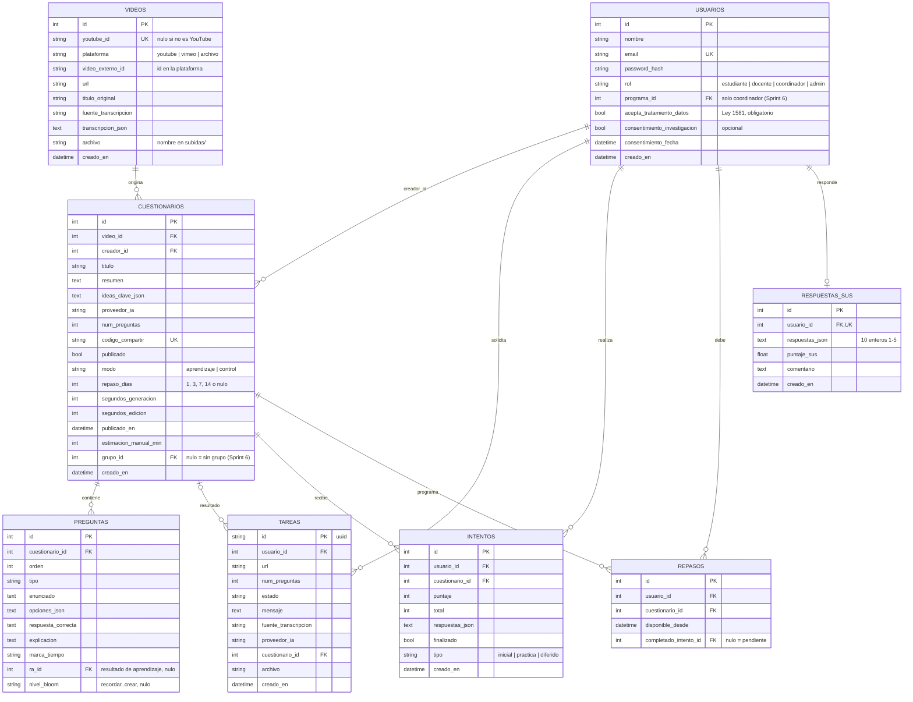
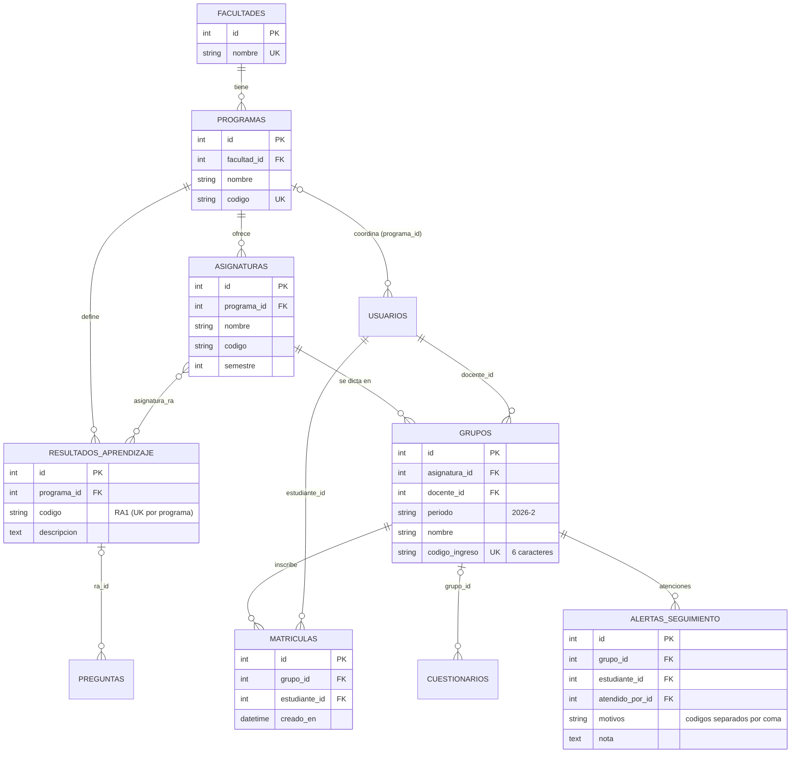
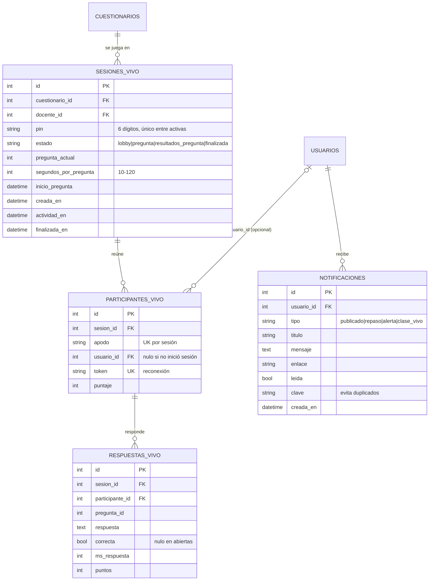
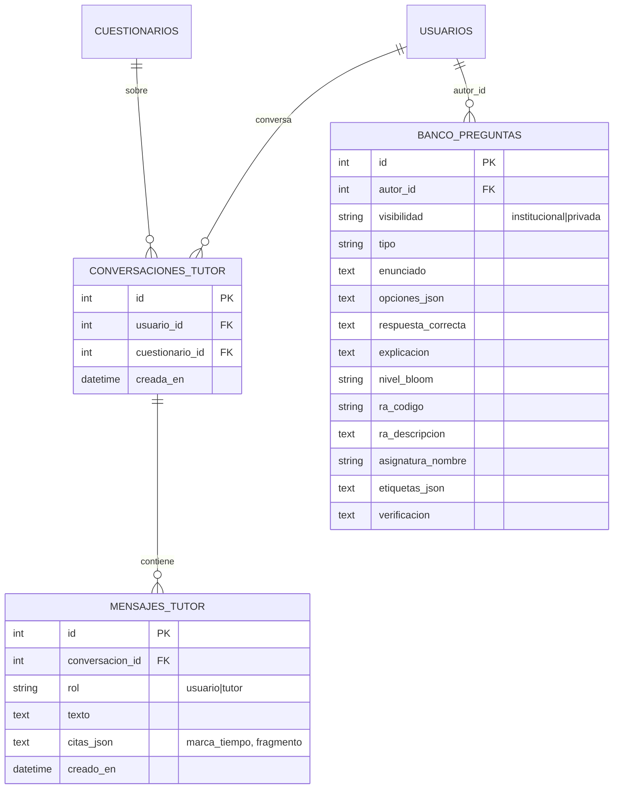

# Manual técnico

## 1. Arquitectura

```mermaid
flowchart TB
    subgraph Cliente
        N[Next.js 16 · App Router · Tailwind]
    end
    subgraph Servidor["Backend FastAPI"]
        R[Routers: auth, procesar, cuestionarios,<br/>intentos, docente, comparar,<br/>medios, estadisticas, sus,<br/>admin, cursos, coordinacion,<br/>vivo (HTTP + WebSocket), notificaciones,<br/>tutor, banco, videos (Sprint 8)]
        S[Seguridad: bcrypt + JWT]
        T[services/transcripcion]
        I[services/ia: generar_con_respaldo]
        M[SQLAlchemy 2]
    end
    N -->|HTTPS · JSON · Bearer JWT| R
    R --> S
    R --> T
    R --> I
    R --> M
    M --> DB[(SQLite / PostgreSQL)]
    R --> FS[(subidas/)]
    T --> YT[youtube-transcript-api]
    T --> YD[yt-dlp + ffmpeg]
    T --> VI[Vimeo vía yt-dlp]
    T --> WH[Groq Whisper]
    I --> GE[Gemini]
    I --> GQ[Groq LLM]
    I --> OL[Ollama]
```

- **Frontend** (`frontend/`): páginas en `src/app`, componentes en `src/components`, utilidades en `src/lib` (`api.ts` cliente HTTP, `auth.tsx` contexto de sesión, `fechas.ts` formato de fechas en hora local, `tipos.ts` tipos que reflejan `schemas_api.py`). El token JWT se guarda en `localStorage`.
- **Backend** (`backend/app`): una aplicación FastAPI con routers por dominio. El esquema `app/schemas.py` pertenece al adaptador de IA; `app/schemas_api.py` define la entrada/salida de la API.
- **Fechas**: la BD guarda UTC. Como SQLite devuelve datetimes sin zona, `schemas_api.FechaUTC` les asigna UTC al validarlos, de modo que siempre se serializan en ISO 8601 con `Z`. El navegador los formatea con `Intl.DateTimeFormat('es-CO')`.

## 2. Proveedor de IA: Strategy + Adapter con respaldo

`app/services/ia/base.py` define la interfaz `ProveedorIA` (`generar()` y `configurado()`) y el prompt común. Cada proveedor (`gemini.py`, `groq_llm.py`, `ollama.py`) es un **adaptador** que oculta su SDK y devuelve el mismo `ResultadoIA` validado por Pydantic. El resto de la aplicación depende solo de la abstracción (patrón **Strategy**).

`generar_con_respaldo(texto, num_preguntas)` (en `services/ia/__init__.py`):

1. Recorre los proveedores en el orden de `PROVEEDORES_IA`.
2. Omite los que no tienen clave (`configurado() == False`).
3. Ante errores **transitorios** (red, timeout, HTTP 429/5xx) reintenta con esperas de 2 s y 5 s (no para Ollama).
4. Si el proveedor sigue fallando, registra el error y **pasa al siguiente**.
5. Si todos fallan, lanza `RuntimeError` con el resumen de fallos, que se muestra al usuario.

Añadir un proveedor nuevo = crear una clase que implemente `ProveedorIA` y registrarla en `PROVEEDORES`.

**Tareas genéricas (Sprint 8).** Además de `generar()`, cada proveedor implementa `completar_json(prompt, esquema_pydantic)` (Gemini con `response_schema`, Groq con modo JSON + el JSON Schema en el prompt y Ollama con `format`). `ejecutar_con_respaldo(prompt, esquema)` reutiliza exactamente la misma lógica de orden de proveedores, reintentos transitorios y respaldo que `generar_con_respaldo` (ambas comparten `_recorrer_proveedores` y `_con_reintentos`) y devuelve `(objeto validado, proveedor)`. Lo usan el tutor, la calificación de abiertas y la verificación de calidad; los servicios lo invocan como `ia.ejecutar_con_respaldo` (atributo del módulo) para poder simularlo en las pruebas.

El prompt exige responder **siempre en español**, aunque la transcripción esté en otro idioma. Whisper detecta el idioma automáticamente salvo que `IDIOMA_TRANSCRIPCION` esté definido.

## 3. Flujo de procesamiento

```mermaid
sequenceDiagram
    actor U as Usuario
    participant F as Frontend
    participant A as API (FastAPI)
    participant B as Tarea en segundo plano
    participant T as Transcripción
    participant I as IA (con respaldo)
    participant D as BD

    U->>F: Pega URL o sube archivo
    F->>A: POST /api/procesar (o /procesar/archivo)
    A->>D: Crea Tarea (pendiente)
    A-->>F: 200 TareaOut (id)
    A->>B: BackgroundTasks
    loop cada pocos segundos
        F->>A: GET /api/tareas/{id}
        A-->>F: estado + mensaje
    end
    B->>D: Estado = transcribiendo
    alt Video ya en caché
        B->>D: Reutiliza transcripción
    else YouTube
        B->>T: Subtítulos; si fallan, yt-dlp + Whisper
    else Vimeo
        B->>T: yt-dlp (audio) + Whisper
    else Archivo
        B->>T: ffmpeg (audio) + Whisper
    end
    B->>D: Estado = generando
    B->>I: generar_con_respaldo(transcripción)
    I-->>B: ResultadoIA + proveedor
    B->>D: Guarda Cuestionario y Preguntas, estado = listo
    F->>A: GET /api/cuestionarios/{id}
```

Las tareas huérfanas (servidor reiniciado a mitad) se marcan como `error` al arrancar.

**Plataformas.** `identificar_video(url)` devuelve `(plataforma, id)` con plataforma `youtube` o `vimeo` (acepta `vimeo.com/123`, `vimeo.com/channels/x/123`, `player.vimeo.com/video/123` y `vimeo.com/123/hash` para no listados). La caché de transcripción busca por `(plataforma, video_externo_id)`. `extraer_video_id` se conserva como envoltorio solo para YouTube. Vimeo no ofrece API de subtítulos: siempre se descarga el audio con yt-dlp y se transcribe con Whisper. Se descarga desde `player.vimeo.com/video/{id}` porque `vimeo.com/{id}` exige iniciar sesión en yt-dlp; los videos con protección DRM o privados fallan con un mensaje claro.

**Transmisiones en vivo y duración.** Antes de descargar audio, `_descargar_audio` llama a `extract_info(download=False)` y `verificar_video_procesable` rechaza `is_live` / `live_status` en (`is_live`, `is_upcoming`, `post_live`) y los videos con `duration` mayor que `MAX_DURACION_MIN` (por defecto 180 min). Si el video de YouTube tiene subtítulos no se hace esta consulta (no se descarga audio).

## 4. Modelo entidad-relación



Tablas: `usuarios`, `videos`, `cuestionarios`, `preguntas`, `tareas`, `intentos`, `repasos`, `respuestas_sus` y, desde el Sprint 8, `conversaciones_tutor`, `mensajes_tutor` y `banco_preguntas` (ver «Sprint 8»); y, desde el Sprint 6, `facultades`, `programas`, `asignaturas`, `resultados_aprendizaje`, `asignatura_ra`, `grupos`, `matriculas` y `alertas_seguimiento`; y, desde el Sprint 7, `sesiones_vivo`, `participantes_vivo`, `respuestas_vivo` y `notificaciones` (ver «Clase en vivo»). Las crea `create_all`; este sprint no añade columnas a tablas existentes.

### Estructura académica (Sprint 6)



Las columnas nuevas de tablas existentes (`usuarios.programa_id`, `cuestionarios.grupo_id`, `preguntas.ra_id`, `preguntas.nivel_bloom`) se migran con `_migrar_columnas()`; las tablas nuevas las crea `create_all`. Las restricciones de borrado se aplican en la API (409 si una facultad tiene programas, un programa tiene asignaturas/RA o una asignatura tiene grupos) porque SQLite no impone claves foráneas por defecto.

**Roles.** `estudiante` y `docente` se crean por el registro público (`RegistroIn.rol` solo admite esos dos). `coordinador` (con `programa_id`) y `admin` los asigna un administrador en `/admin` (o el script `sembrar_estructura.py`). Las dependencias de `seguridad.py` son `requiere_docente`, `requiere_rol(*roles)`, `requiere_admin`, `requiere_coordinacion` (coordinador o admin) y `requiere_seguimiento` (docente, coordinador o admin).

Las tablas se crean con `Base.metadata.create_all`; las columnas añadidas después del Sprint 2 se migran con `_migrar_columnas()` en `db.py` (`ALTER TABLE ADD COLUMN` si faltan; la primera vez que se añade una columna también rellena los datos previos: `plataforma` y `video_externo_id` de los videos, `tipo` de los intentos —el primero finalizado de cada usuario por cuestionario es `inicial` y los demás `practica`— y `publicado_en` de los cuestionarios ya publicados). Las cuentas anteriores al Sprint 5 quedan con `acepta_tratamiento_datos = false` y se les pide aceptar la política en «Mi cuenta». Borrar un cuestionario elimina en cascada sus preguntas e intentos; si su video era un archivo subido y nadie más lo usa, también se elimina el archivo de `subidas/`.

## 5. Referencia de endpoints

Todos los endpoints (salvo los marcados «público») exigen la cabecera `Authorization: Bearer <token>`.

| Método | Ruta | Permisos | Descripción |
|---|---|---|---|
| GET | `/api/salud` | público | Estado del servicio y proveedores de IA configurados. |
| POST | `/api/auth/registro` | público | Crea una cuenta (rol estudiante/docente) y devuelve el token. Exige `acepta_tratamiento_datos: true` (422 si no); `consentimiento_investigacion` es opcional. 409 si el correo existe. |
| POST | `/api/auth/login` | público | Inicia sesión y devuelve el token. 401 si las credenciales son incorrectas. |
| GET | `/api/auth/yo` | autenticado | Datos del usuario actual (incluye los consentimientos). |
| PATCH | `/api/auth/cuenta` | autenticado | Edita nombre, contraseña (`password_actual` obligatoria; 400 si es incorrecta) y consentimientos (`consentimiento_investigacion`, `acepta_tratamiento_datos`). |
| GET | `/api/auth/mis-datos` | autenticado | Derecho de acceso: JSON con usuario, cuestionarios, intentos, repasos y encuesta. |
| DELETE | `/api/auth/cuenta` | autenticado | Derecho de supresión: cuerpo `{password}` (400 si es incorrecta); borra intentos, repasos, encuesta, tareas, cuestionarios propios con preguntas y archivos subidos. |
| POST | `/api/procesar` | autenticado | Procesa una URL de YouTube o Vimeo en segundo plano; devuelve la tarea. 400 URL inválida, 429 límite diario. Las transmisiones en vivo y los videos de más de `MAX_DURACION_MIN` terminan en `error` con un mensaje claro. |
| POST | `/api/procesar/archivo` | autenticado | Sube un video/audio (multipart: `archivo`, `num_preguntas`) y lo procesa. 400 formato, 413 tamaño. |
| GET | `/api/tareas/{id}` | dueño de la tarea | Estado de una tarea de procesamiento. |
| GET | `/api/cuestionarios` | autenticado | Cuestionarios propios y los ajenos publicados con intentos del usuario. |
| GET | `/api/cuestionarios/{id}` | creador o publicado | Detalle; las respuestas correctas solo se incluyen para el creador. |
| DELETE | `/api/cuestionarios/{id}` | creador | Elimina el cuestionario, sus intentos y, si procede, el archivo subido. |
| POST | `/api/cuestionarios/{id}/intentos` | creador o publicado | Inicia un intento y devuelve `tipo` (`inicial`, `practica` o `diferido`) y `con_feedback`. Es `diferido` si el usuario tiene un repaso vencido sin completar. |
| POST | `/api/intentos/{id}/responder` | dueño del intento | Califica una respuesta en el servidor y devuelve retroalimentación. En intentos diferidos y en el modo control devuelve solo `registrada` (`con_feedback: false`). 409 si ya se respondió o el intento terminó. |
| POST | `/api/intentos/{id}/finalizar` | dueño del intento | Calcula el puntaje final (las abiertas solo cuentan si el docente aprobó su nota; ver «Sprint 8»), fija el `tipo` definitivo, crea el repaso tras el intento inicial o lo marca como completado. En un diferido (modo aprendizaje) incluye `revision` con las respuestas correctas. |
| GET | `/api/intentos` | autenticado | Historial de intentos finalizados del usuario. |
| GET | `/api/repasos` | autenticado | Repasos pendientes del usuario: vencidos (`vencido: true`) y próximos con su fecha. |
| POST | `/api/cuestionarios/{id}/publicar` | docente creador | Publica o despublica; admite `estimacion_manual_min` opcional. Fija `publicado_en` la primera vez. |
| POST | `/api/cuestionarios/{id}/duplicar` | docente creador | `{modo, titulo?}`: copia con preguntas, código nuevo y estado borrador (p. ej. versión grupo control). |
| POST | `/api/cuestionarios/{id}/tiempo-edicion` | docente creador | `{segundos}` (1 a 14 400): suma el tiempo activo de una sesión de edición. |
| GET | `/api/compartido/{codigo}` | autenticado | Resuelve un código de 6 caracteres a un cuestionario publicado. |
| PATCH | `/api/cuestionarios/{id}` | docente creador | Edita título, resumen e ideas clave, y configura `repaso_dias` (1, 3, 7, 14 o `null`) y `estimacion_manual_min`. |
| PUT | `/api/preguntas/{id}` | docente creador | Edita una pregunta (validada; 422 si es inconsistente). |
| POST | `/api/cuestionarios/{id}/preguntas` | docente creador | Agrega una pregunta. |
| DELETE | `/api/preguntas/{id}` | docente creador | Elimina una pregunta y reordena. |
| POST | `/api/cuestionarios/{id}/reordenar` | docente creador | Reordena las preguntas con una lista de ids. |
| GET | `/api/cuestionarios/{id}/resultados` | docente creador | Intentos (con tipo y consentimiento), acierto por pregunta, respuestas abiertas, **ganancia de aprendizaje** y **retención**. |
| GET | `/api/cuestionarios/{id}/resultados.csv` | docente creador | Igual en CSV (BOM UTF-8, anti-inyección de fórmulas, secciones de ganancia y retención, columnas «Tipo de intento» y «Consentimiento investigación»). Incluye a todos los estudiantes del curso. |
| GET | `/api/comparar?a={id}&b={id}` | docente creador de ambos | n, media y desviación muestral por grupo del intento inicial, el diferido y la retención; diferencia de medias, d de Cohen e interpretación. 400 si `a == b`. |
| GET | `/api/comparar.csv?a={id}&b={id}` | docente creador de ambos | Datos por estudiante (`E1..En`, inicial, diferido, retención) **solo de quienes aceptaron participar en la investigación**. |
| GET | `/api/medios/{nombre}` | público | Sirve un archivo subido (con `Range`). El nombre debe ser `uuid-hex.extensión`; 400 si no. |
| GET | `/api/estadisticas/yo` | autenticado | Métricas personales (incluye `retencion_promedio`); si es docente añade el bloque `docente` con el ahorro de tiempo. |
| POST | `/api/sus` | autenticado | Guarda (o actualiza) la respuesta SUS: `respuestas` (10 enteros 1–5) y `comentario` opcional. |
| GET | `/api/sus/mia` | autenticado | Tu respuesta SUS; 404 si no has respondido. |
| GET | `/api/sus/resumen` | docente | n, promedio, desviación estándar muestral, mín., máx., distribución por interpretación y promedio por ítem. |
| GET | `/api/sus/resumen.csv` | docente | CSV anónimo (id secuencial, rol, 10 respuestas, puntaje, comentario, fecha) **solo de usuarios con consentimiento de investigación**. |

### Endpoints del Sprint 6

| Método | Ruta | Permisos | Descripción |
|---|---|---|---|
| GET/POST | `/api/admin/facultades` · PATCH/DELETE `/{id}` | admin | CRUD de facultades (409 si el nombre se repite o si tiene programas). |
| GET/POST | `/api/admin/programas` · PATCH/DELETE `/{id}` | admin | CRUD de programas (`facultad_id`, `nombre`, `codigo` único). |
| GET/POST | `/api/admin/asignaturas` (`?programa_id`) · PATCH/DELETE `/{id}` | admin | CRUD de asignaturas (`programa_id`, `nombre`, `codigo`, `semestre`); no se elimina con grupos. |
| PUT | `/api/admin/asignaturas/{id}/ras` | admin | `{ra_ids}`: RA que aporta la asignatura (deben ser del mismo programa). |
| GET/POST | `/api/admin/ras` (`?programa_id`) · PATCH/DELETE `/{id}` | admin | CRUD de resultados de aprendizaje (código único por programa). Al eliminar uno, sus preguntas quedan sin RA. |
| GET | `/api/admin/usuarios` | admin | Lista de usuarios con rol y programa. |
| PATCH | `/api/admin/usuarios/{id}` | admin | Cambia `rol` y `programa_id` (solo tiene efecto en coordinadores). Un admin no puede quitarse su propio rol. |
| GET | `/api/catalogo/asignaturas` | docente, coordinador, admin | Asignaturas disponibles para crear grupos. |
| GET | `/api/grupos` | docente (sus grupos), coordinador (su programa), admin (todos) | Grupos con código de ingreso, nº de matriculados y de cuestionarios. |
| POST | `/api/grupos` | docente | `{asignatura_id, periodo "AAAA-S", nombre}`: crea un grupo con código de ingreso único de 6 caracteres. |
| PATCH/DELETE | `/api/grupos/{id}` | docente dueño (o admin) | Edita nombre/periodo o elimina (los cuestionarios quedan sin grupo). |
| POST | `/api/grupos/{id}/nuevo-codigo` | docente dueño (o admin) | Renueva el código de ingreso. |
| GET | `/api/grupos/{id}/matriculados` | quien ve el grupo | Estudiantes matriculados. |
| DELETE | `/api/grupos/{id}/matriculados/{estudiante_id}` | docente dueño (o admin) | Quita a un estudiante del grupo. |
| POST | `/api/mis-cursos/unirse` | estudiante | `{codigo}`: matricula al estudiante (404 código inexistente, 409 ya matriculado). |
| GET | `/api/mis-cursos` | estudiante | Sus cursos con los cuestionarios **publicados** asignados al grupo y su mejor resultado. |
| DELETE | `/api/mis-cursos/{grupo_id}` | estudiante | Salir del curso. |
| GET | `/api/cuestionarios/{id}/ras` | docente creador | RA elegibles: los de la asignatura del grupo del cuestionario (lista vacía sin grupo). |
| PATCH | `/api/cuestionarios/{id}` | docente creador | Acepta además `grupo_id` (uno de sus grupos; `null` lo quita). Al cambiar de grupo se limpian los RA de las preguntas. `POST .../publicar` también admite `grupo_id`. |
| PUT/POST | `/api/preguntas/{id}` · `/api/cuestionarios/{id}/preguntas` | docente creador | Aceptan `ra_id` (debe pertenecer a la asignatura del grupo; 400 si no) y `nivel_bloom` (`recordar`, `comprender`, `aplicar`, `analizar`, `evaluar`, `crear`; 422 si es otro valor). |
| GET | `/api/coordinacion/resumen?programa_id&periodo` | coordinador (su programa), admin (uno o todos) | Logro por RA, por nivel de Bloom, por asignatura/grupo, tendencia semanal y lista de periodos. 400 si el coordinador no tiene programa; 403 si pide otro programa. |
| GET | `/api/coordinacion/reporte-ra.pdf?programa_id&periodo` | coordinador, admin | Reporte institucional en PDF (`application/pdf`). |
| GET | `/api/cuestionarios/{id}/reporte.pdf` | docente creador | PDF con resultados del cuestionario y su grupo. |
| GET | `/api/alertas?grupo_id` | docente (sus grupos), coordinador (su programa), admin | Alertas tempranas vigentes (calculadas al vuelo). |
| POST | `/api/alertas/atender` | ídem | `{grupo_id, estudiante_id, nota}`: registra la atención de la alerta vigente (404 si no hay). |
| GET | `/api/alertas/seguimientos` | ídem | Historial de atenciones. |

### Logro por resultado de aprendizaje

`services/logro.py`. Solo cuentan las respuestas a preguntas **cerradas** (las abiertas no se califican) de intentos **finalizados** de estudiantes **matriculados** en el grupo al que está asignado el cuestionario; los intentos del creador no cuentan. Logro = aciertos ÷ respuestas × 100. Semáforo: `>= 70` verde, `50 a 69` amarillo, `< 50` rojo, sin respuestas = sin datos. El filtro de periodo usa `Grupo.periodo`. La tendencia agrupa las respuestas por semana (lunes) de la fecha del intento. El nivel de Bloom y el RA se asignan por pregunta; las respuestas a preguntas sin RA/Bloom no entran en esas vistas pero sí en el logro global, por asignatura y por grupo.

### Alertas tempranas

`services/alertas.py`; no se almacenan, se calculan por estudiante matriculado en cada consulta (cada alerta explica su motivo en texto):

| Código | Regla |
|---|---|
| `inactividad` | 14 días o más sin intentos (se toma el más reciente entre el último intento y la fecha de matrícula, de modo que una matrícula nueva no alerta). |
| `bajo_promedio` | Promedio de los intentos `inicial` finalizados en los cuestionarios del grupo menor a 60 %. |
| `repasos_vencidos` | 2 o más repasos diferidos vencidos sin completar. |
| `caida` | El último intento del grupo es 20 puntos porcentuales o más inferior al anterior. |

Nivel `alto` con 2 o más motivos; `medio` con uno. «Marcar como atendida» guarda en `alertas_seguimiento` los códigos vigentes; la alerta no vuelve a mostrarse mientras sus motivos sean un subconjunto de los de la atención más reciente (reaparece si surge un motivo nuevo).

### Reportes PDF

`services/reportes_pdf.py` (reportlab, fuente Helvetica sin incrustar tipografías): franja azul `#0B468A` con línea naranja `#E88A37`, título, programa, periodo y fecha de generación; tablas con barras de logro por semáforo; pie «Plataforma de Aprendizaje Activo — Proyecto académico CUL» y «Página n de m» (lienzo de dos pasadas). Dos reportes: resultados de aprendizaje del programa y resultados de un cuestionario/grupo.

### Cálculo SUS

Ítems impares (1, 3, 5, 7, 9) aportan `r − 1`; pares (2, 4, 6, 8, 10) aportan `5 − r`. La suma (0–40) se multiplica por 2,5. Interpretación: `< 51` Pobre · `51–68` Aceptable bajo · `68–80,3` Bueno · `> 80,3` Excelente. Implementado en `app/services/sus.py`.

### Ganancia de aprendizaje

Por cada estudiante con ≥ 2 intentos finalizados en el cuestionario se toma el porcentaje del primer y del último intento (ordenados por fecha). Se reporta el promedio de ambos y la diferencia en puntos porcentuales (medida pre-test/post-test).

### Repaso diferido y retención

Mide la **retención** del aprendizaje (post-test diferido).

- El docente fija `repaso_dias` (1, 3, 7 o 14) en el cuestionario. Cada intento tiene un `tipo`: `inicial`, `practica` o `diferido`.
- Al **finalizar** el primer intento (no diferido) de un estudiante, ese intento queda como `inicial` y, si hay `repaso_dias`, se crea un `Repaso` con `disponible_desde = ahora + repaso_dias`. Los siguientes intentos son `practica`. El **creador** del cuestionario no recibe repasos (sus intentos son pruebas).
- Al **crear** un intento, si el usuario tiene un `Repaso` vencido sin completar, el intento es `diferido`. Mientras ese repaso no se complete, cualquier intento nuevo es diferido.
- En un intento diferido el endpoint `responder` devuelve solo `{registrada: true, con_feedback: false}`; al finalizar, la respuesta incluye `revision` con las respuestas correctas y el `Repaso` queda completado (`completado_intento_id`).
- **Retención** de un estudiante = % del diferido / % del inicial × 100 (no se define si el inicial fue 0 %). En los resultados del docente: promedio inicial, promedio diferido, `retencion_pct` = promedio diferido / promedio inicial × 100 y la diferencia en puntos. La **ganancia de aprendizaje** ignora los intentos diferidos.

### Modo grupo control (diseño cuasi-experimental)

`Cuestionario.modo` es `aprendizaje` (por defecto) o `control`. En un cuestionario de control el servidor entrega a los estudiantes `resumen = ""`, `ideas_clave = []` y sin marcas de tiempo; `responder` nunca da retroalimentación y `finalizar` devuelve solo el puntaje (sin `revision`, ni siquiera en el diferido). El docente crea la versión de control con `POST /api/cuestionarios/{id}/duplicar`.

### Comparación de grupos

`GET /api/comparar` toma, por estudiante (sin contar al creador), el intento inicial y el diferido más antiguos, y calcula por grupo `n`, media y desviación estándar **muestral** (n − 1; nula con n < 2) de: inicial, diferido y retención. La diferencia de medias es A − B. La **d de Cohen** usa la desviación combinada, `sp = √(((n₁−1)s₁² + (n₂−1)s₂²) / (n₁+n₂−2))` y `d = (m_A − m_B) / sp`; se interpreta por |d|: < 0,2 trivial, < 0,5 pequeño, < 0,8 mediano, ≥ 0,8 grande. No es una prueba de hipótesis: la respuesta recuerda usar la prueba t de Welch en JASP/Excel con el CSV. Código en `app/services/estadistica.py`.

### Tiempo del docente

`segundos_generacion` se guarda cuando la tarea llega a `listo` (tiempo desde que se creó la tarea). El editor mide el **tiempo activo** (solo con la pestaña visible) y lo envía a `POST /tiempo-edicion` al guardar, cancelar, salir y cada 5 min. Para los cuestionarios con `estimacion_manual_min`: tiempo con la herramienta = `segundos_generacion + segundos_edicion`; ahorro % = (manual − herramienta) / manual × 100, calculado con los promedios (`estadisticas/yo` → `docente.tiempo`). Las copias creadas con «duplicar» parten de 0 s y sin estimación.

### Clase en vivo (Sprint 7)

Modo estilo Kahoot: el docente proyecta las preguntas y los participantes (con o sin cuenta) responden desde el celular.



**Arquitectura.** `services/vivo.py` mantiene el estado de cada sesión activa en memoria (`SesionMem`, con un `threading.RLock`) y lo persiste en la BD en cada transición, al unirse alguien y con cada respuesta; tras un reinicio del servidor, la sesión se reconstruye desde la BD al primer acceso. El **temporizador lo controla el servidor** (`asyncio.create_task` + `sleep`); el cliente solo dibuja la cuenta regresiva a partir de `restante_ms`. Cuando todos los participantes responden, la pregunta se cierra sin esperar. El servidor siempre envía el **estado completo** (snapshot), de modo que reconectar equivale a recibir de nuevo el estado actual.

**Flujo de estados.** `lobby` → `pregunta` → `resultados_pregunta` → (siguiente) `pregunta` … → `finalizada`. Acciones del presentador: `iniciar`, `siguiente`, `saltar` (cierra la pregunta abierta o avanza) y `finalizar`.

**Puntaje.** Correcta = `round(500 + 500 × tiempo_restante / tiempo_total)`; incorrecta o sin responder = 0; las preguntas abiertas se responden pero no puntúan (el presentador ve las respuestas como nube). Se admite 1,5 s de margen por latencia de red.

**Endpoints.**

| Método | Ruta | Permisos | Descripción |
|---|---|---|---|
| POST | `/api/cuestionarios/{id}/vivo` | docente dueño | Crea la sesión (`segundos_por_pregunta` 10–120, por defecto 30) y devuelve el PIN. Cualquier estado de publicación. |
| GET | `/api/vivo/sesiones/{id}` | docente dueño | Datos de la sesión (PIN, estado). 410 si ya terminó. |
| POST | `/api/vivo/sesiones/{id}/accion` | docente dueño | Controles por HTTP (respaldo): `iniciar`, `siguiente`, `saltar`, `finalizar`. |
| POST | `/api/vivo/unirse` | público (con JWT vincula el usuario) | `{pin, apodo}` → token del participante. Apodo 2–20 caracteres, sin palabras ofensivas, único en la sesión (409). Máximo 200 participantes. |
| GET | `/api/vivo/{pin}/estado` | participante (`?participante=token`), presentador (JWT) o público (datos mínimos) | Sondeo de respaldo. |
| POST | `/api/vivo/{pin}/responder` | participante (token en el cuerpo) | Respuesta por HTTP (respaldo). |
| WS | `/ws/vivo/{pin}?token=<JWT>` o `?participante=<token>` | docente dueño / participante | Tiempo real. Cierres: 4404 PIN inexistente, 4403 JWT que no es del dueño, 4401 sin credenciales válidas. |
| GET | `/api/cuestionarios/{id}/vivo` | docente dueño | Historial: fecha, participantes, acierto promedio y % por pregunta. |
| GET | `/api/cuestionarios/{id}/vivo.csv` | docente dueño | CSV (BOM UTF-8, protección de fórmulas): sesiones, preguntas y participantes. |

**Protocolo WebSocket.** Cliente → servidor: `{"accion": "iniciar|siguiente|saltar|finalizar"}` (presentador), `{"accion": "responder", "respuesta": "..."}` (participante) y `{"accion": "ping"}`. Servidor → cliente: `{"tipo": "estado", ...}` (snapshot con `estado`, `pregunta` sin la respuesta correcta, `respondieron`, `restante_ms`, `participantes`, `resultados` solo tras el cierre, `ranking` top 5 y `yo` para el participante) y `{"tipo": "error", "mensaje": ...}`.

**Reconexión y respaldo.** El cliente (`frontend/src/lib/vivo.ts`) guarda el token del participante en `localStorage` (`vivo:{pin}`), reintenta con *backoff* exponencial (0,5 s … 8 s) y, tras **3 fallos seguidos** del WebSocket, pasa a sondear `GET /api/vivo/{pin}/estado` cada 1,5 s; los controles y las respuestas viajan entonces por HTTP.

**Seguridad y límites.** Las respuestas correctas (y la explicación) solo aparecen en el snapshot `resultados_pregunta` o `finalizada`; el sondeo público no revela ni la pregunta. Solo el docente dueño controla la sesión (JWT). Máximo 200 participantes. Una sesión sin actividad durante 2 h se finaliza sola (al consultarla y con un bucle de mantenimiento cada 5 min iniciado en el `lifespan`). Los participantes con cuenta reciben una notificación con su puesto al finalizar.

**Despliegue.** El estado en memoria exige **un solo proceso** de uvicorn por instancia (sin `--workers` mayor que 1) y un servidor que admita WebSockets (Render lo admite); para que el navegador use `wss://`, `NEXT_PUBLIC_API_URL` debe ser `https://`.

### Notificaciones en la app (Sprint 7)

Modelo `Notificacion` (usuario, tipo, título, mensaje, enlace, leída, creada_en y `clave`, única por usuario, que evita duplicados). Se generan: **cuestionario publicado** en un grupo (a los matriculados, una vez por cuestionario); **repaso disponible** y **alerta temprana** (al consultar las notificaciones: el repaso cuando vence sin completarse; las alertas se calculan como máximo cada 2 min por docente con las reglas del Sprint 6); y **resultado de clase en vivo** (participantes con cuenta). Endpoints: `GET /api/notificaciones?pagina&por_pagina&solo_no_leidas`, `GET /api/notificaciones/no-leidas`, `POST /api/notificaciones/{id}/leer` y `POST /api/notificaciones/leer-todas`. Cada usuario solo accede a las suyas (404 si no lo son). El frontend sondea el contador cada 60 s (`CampanaNotificaciones.tsx`, sin WebSocket); el panel ocupa toda la pantalla en móvil y existe la página `/notificaciones`. Al eliminar la cuenta se borran sus notificaciones y sus participaciones en clases en vivo quedan anónimas.

## 5b. Sprint 8: tutor IA, calificación de abiertas, calidad, psicometría, banco y subtítulos



Columnas nuevas (migradas por `_migrar_columnas`): `preguntas.verificacion` (JSON, nulo = sin verificar) y `preguntas.banco_id` (entero sin clave foránea: id de la pregunta del banco de la que proviene o a la que dio origen).

### Tutor IA («Pregúntale al video»)

`services/tutor.py` + `routers/tutor.py`. **Sin vectores**: el prompt lleva la transcripción completa con marcas `[mm:ss]`; si supera 300 000 caracteres (`MAX_CONTEXTO`) se seleccionan los segmentos con más coincidencias de palabras clave (sin acentos ni palabras vacías) con la pregunta, más un segmento vecino a cada lado, en orden cronológico. Se añade el historial de los **últimos 6 mensajes** de la conversación activa.

- **Respuesta estructurada** (`RespuestaTutor`): `texto` y `citas[{marca_tiempo, fragmento}]`. `validar_citas` descarta las citas con marca que no sea `mm:ss`, que supere la duración del video (+60 s), sin fragmento o repetidas; normaliza la marca y conserva como máximo 4.
- **Reglas del prompt**: responder solo con la transcripción; si no está, decirlo («Eso no se explica en este video»); la pregunta del estudiante es dato, no instrucciones. **Intento en curso**: se pasan al modelo solo los **enunciados** de las preguntas aún sin responder (nunca opciones, respuesta correcta ni explicación) con la orden de guiar sin revelar.
- **Disponibilidad**: `GET /api/cuestionarios/{id}/tutor` devuelve `habilitado`/`motivo`. Se bloquea (403 al preguntar) en modo `control`, con un intento `diferido` en curso o con un repaso vencido sin completar (el siguiente intento sería diferido). El cuestionario debe ser visible para el usuario (creador o publicado).
- **Límite**: `LIMITE_TUTOR_DIARIO` (30) mensajes del usuario en 24 h móviles, sumando todas sus conversaciones; 429 al superarlo. Un fallo de la IA responde 503 y no guarda ni cuenta el mensaje.
- **Persistencia**: `ConversacionTutor`/`MensajeTutor` por usuario y cuestionario; la conversación activa es la más reciente y «Nueva conversación» crea otra (las anteriores quedan guardadas). Se borran con el cuestionario y con la cuenta.
- **Sugerencias**: tres preguntas generadas de las ideas clave, sin IA (`sugerencias_iniciales`).

### Calificación de preguntas abiertas con IA

`services/calificacion.py`. Al responder una abierta, `calificar_abierta` envía enunciado, respuesta modelo, explicación y la respuesta del estudiante (entre marcadores, tratada como dato) con una rúbrica fija y guarda en la respuesta (`Intento.respuestas_json`) el campo `ia = {puntaje 0–100, nivel, retroalimentacion, falto, proveedor}`. El **nivel se deriva del puntaje** (insuficiente 0–39, básico 40–64, bueno 65–84, excelente 85–100), de modo que siempre es coherente. Una respuesta vacía vale 0 sin llamar a la IA. Si la IA falla no se bloquea la respuesta (no hay sugerencia). El estudiante recibe `calificacion_ia` solo con retroalimentación (no en control ni en diferido); el docente siempre ve la sugerida.

El docente fija la nota final con `PUT /api/intentos/{intento}/abiertas/{pregunta}/nota` `{nota 0–100}`; se guarda `nota_final` en la respuesta y, si el intento ya está finalizado, se recalcula. **Fórmula del puntaje** (`calcular_puntaje`):

```
puntaje = round(aciertos_cerradas + Σ nota_final_i / 100)
total   = preguntas_cerradas + número de abiertas con nota_final
```

Sin abiertas aprobadas es idéntico al cálculo anterior (aciertos / cerradas), por lo que no cambian los cálculos de ganancia, retención ni comparación. El logro por RA/Bloom sigue usando solo las cerradas.

### Verificación de calidad de las preguntas

`services/verificacion.py`. Tras guardar el cuestionario generado se hace **una llamada en lote** (`LoteVerificacion`) con la transcripción y todas las preguntas. Para cada una se guarda en `Pregunta.verificacion` `{estado, respaldo (si|parcial|no), cita, marca_tiempo, inequivoca, problemas[], proveedor}`; `estado = verificada` solo si `respaldo == si`, la respuesta es inequívoca y no hay problemas; si no, `revisar`. **Si la IA falla, el cuestionario queda `listo` con las preguntas «sin verificar»** (`verificacion = NULL`); `POST /api/cuestionarios/{id}/verificar` la repite (503 si sigue caída). Editar el enunciado, las opciones, el tipo o la respuesta correcta de una pregunta descarta su verificación; editar otros campos no. El creador la recibe en `PreguntaOut.verificacion`; los estudiantes, nunca.

### Análisis de ítems (psicometría clásica)

`services/psicometria.py` (puro, sin BD; `routers/docente._analisis_items` lo alimenta con los intentos **iniciales finalizados**, uno por estudiante, y solo preguntas cerradas). Con *N* estudiantes y puntaje total *T* (cerradas acertadas):

| Índice | Definición |
|---|---|
| Dificultad `p` | aciertos ÷ respuestas del ítem. ≥ 0,85 «Muy fácil»; ≥ 0,70 «Fácil»; ≥ 0,30 «Dificultad adecuada»; ≥ 0,15 «Difícil»; menor «Muy difícil». |
| Discriminación `D` | `p(27 % superior) − p(27 % inferior)`, con *k* = máx(1, redondeo(0,27 · N)) estudiantes por grupo, ordenados por *T* (estable en empates). ≥ 0,40 «Discrimina muy bien»; ≥ 0,30 «bien»; ≥ 0,20 «aceptable»; ≥ 0 «poco»; negativa «Discriminación negativa» (revisar). |
| Punto-biserial `r_pb` | `(M1 − M0) / s · √(p·q)`, con M1/M0 las medias de *T* de quienes acertaron/fallaron, *s* la desviación poblacional de *T* y *T* incluye el ítem. `null` si no hay varianza. |
| Distractores | % que elige cada opción; **no funcional** si lo elige < 5 %; **confunde a los mejores** si lo elige un % mayor del grupo superior que del inferior. |

Mínimo de **5 respuestas** por pregunta (`MINIMO_RESPUESTAS`); con menos, `suficiente = false` («datos insuficientes»). `ResultadosOut` añade `items`, `items_minimo` e `items_intentos`; el PDF de resultados incluye la tabla «Análisis de ítems».

### Banco de preguntas institucional

`routers/banco.py`, modelo `PreguntaBanco`. `POST /api/preguntas/{id}/banco` (docente creador) copia la pregunta con RA (código y descripción), Bloom, asignatura (la del grupo del cuestionario o la indicada), etiquetas (máx. 10 de 30 caracteres), verificación y autor, y fija `Pregunta.banco_id` (409 si ya está). **Visibilidad**: `institucional` (docentes, coordinadores y admin) o `privada` (solo el autor; para los demás es un 404). Búsqueda `GET /api/banco` por texto (cada palabra debe aparecer en enunciado, opciones, etiquetas o respuesta) y filtros `asignatura`, `ra`, `bloom`, `tipo`, `verificacion` (`verificada|revisar|sin_verificar`), `solo_mias`, paginada; las **estadísticas acumuladas** (usos, respuestas y % de acierto de las copias en cuestionarios, intentos finalizados) se calculan al consultar. `POST /api/banco/{id}/agregar` copia la pregunta al final de un cuestionario propio (sin marca de tiempo y con la verificación vacía, porque pertenece a otro video; asigna el RA si la asignatura del grupo tiene uno con el mismo código). Solo el autor edita (`PATCH`: visibilidad, etiquetas) o elimina; al eliminar, las copias conservan su contenido.

### Subtítulos y transcripción

`services/subtitulos.py`, `routers/videos.py`. `GET /api/videos/{id}/subtitulos.vtt` genera WebVTT desde los segmentos (cabecera `WEBVTT`, tiempos `HH:MM:SS.mmm`; el fin de cada cue es el inicio del siguiente, con máximo 8 s, y 4 s el último; se escapan `&`, `<` y `>`). `transcripcion.txt` (descarga con marcas `[mm:ss]`) y `transcripcion` (JSON para el panel) usan el mismo control de acceso: el usuario debe ser creador de un cuestionario con ese video o ver uno publicado (404 en otro caso). Como `<track>` no puede enviar el JWT, el frontend descarga el VTT con `fetch` y lo sirve como URL de objeto (`blob:`). En el visor de archivos se usa `<track kind="captions" srclang="es" default>`; en YouTube/Vimeo el panel «Transcripción» (lista clicable + buscador) usa el mismo salto de reproductor que las marcas de tiempo, y con HTML5 resalta el segmento actual según `timeupdate`.

### Endpoints del Sprint 8

| Método | Ruta | Permisos | Descripción |
|---|---|---|---|
| GET | `/api/cuestionarios/{id}/tutor` | creador o publicado | Estado del tutor: disponibilidad y motivo, mensajes de la conversación activa, mensajes restantes y 3 sugerencias. |
| POST | `/api/cuestionarios/{id}/tutor` | ídem | `{pregunta}` (1–1000): respuesta con citas. 403 bloqueado, 429 límite, 503 IA caída. |
| POST | `/api/cuestionarios/{id}/tutor/nueva` | ídem | Nueva conversación. |
| PUT | `/api/intentos/{intento}/abiertas/{pregunta}/nota` | docente creador | Aprueba o ajusta la nota final (0–100) de una abierta; devuelve el resumen del intento recalculado. |
| POST | `/api/cuestionarios/{id}/verificar` | docente creador | (Re)verifica la calidad de todas las preguntas. |
| POST | `/api/preguntas/{id}/banco` | docente creador | Guarda la pregunta en el banco (`visibilidad`, `etiquetas`, `asignatura_nombre`). |
| GET | `/api/banco` · `/api/banco/filtros` | docente, coordinador, admin | Búsqueda paginada y valores para los filtros. |
| PATCH/DELETE | `/api/banco/{id}` | autor | Cambia visibilidad/etiquetas o elimina. |
| POST | `/api/banco/{id}/agregar` | docente | `{cuestionario_id}`: copia la pregunta a un cuestionario propio. |
| GET | `/api/videos/{id}/subtitulos.vtt` · `transcripcion.txt` · `transcripcion` | creador o publicado | WebVTT, descarga de texto y JSON de segmentos. |

`GET /api/cuestionarios/{id}` añade `video_id` y, para el creador, `verificacion` y `banco_id` por pregunta. `POST /api/intentos/{id}/responder` añade `calificacion_ia` (solo preguntas abiertas con retroalimentación; si no hay, la clave se omite). `GET .../resultados` añade `items`, `sugerida`, `nota_final` e `intento_id` en las respuestas abiertas.

## 6. Seguridad

- **Contraseñas**: bcrypt con sal por contraseña (se limita a 72 bytes, el máximo de bcrypt).
- **Sesión**: JWT HS256 firmado con `SECRET_KEY`, con expiración (`TOKEN_EXPIRA_HORAS`). Si falta la clave, el servidor se niega a emitir tokens.
- **Autorización**: dependencias `usuario_actual`, `requiere_docente` y, desde el Sprint 6, `requiere_rol`/`requiere_admin`/`requiere_coordinacion`/`requiere_seguimiento` (403 si el rol no corresponde); el coordinador solo accede a su programa y el docente a sus grupos; comprobación de propiedad en cada recurso (cuestionario, pregunta, intento, tarea).
- **Calificación en servidor**: el cliente nunca recibe `respuesta_correcta` ni `explicacion` hasta responder (salvo el creador); las respuestas se comparan normalizadas (minúsculas y espacios).
- **Validación de entradas**: Pydantic en todos los cuerpos (rangos, longitudes, coherencia de las preguntas, marcas `mm:ss`, SUS 1–5).
- **Medios**: los archivos se guardan con nombre aleatorio `uuid.ext`, solo extensiones permitidas, tamaño máximo configurable y lectura por trozos; el endpoint de descarga acepta únicamente nombres con ese patrón (impide *path traversal*).
- **CSV**: BOM UTF-8 y prefijo `'` en celdas que comienzan por `=`, `+`, `-` o `@` (inyección de fórmulas). El CSV de SUS es anónimo.
- **CORS**: solo los orígenes de `FRONTEND_URL` (admite varios, separados por comas).
- **Límite de uso**: máximo `LIMITE_DIARIO_PROCESAMIENTOS` videos por usuario y 24 h.
- **Secretos**: `.env` está en `.gitignore`; regenera las claves antes de publicar el repositorio.
- **Datos personales (Ley 1581 de 2012)**: el registro exige aceptar la política (`/privacidad`); el consentimiento de investigación es opcional y revocable. Los derechos de acceso (`mis-datos`), rectificación (`PATCH /auth/cuenta`) y supresión (`DELETE /auth/cuenta`, con contraseña) están en la página `/cuenta`. Las exportaciones con fines de investigación (`sus/resumen.csv`, `comparar.csv`) incluyen solo a quienes consintieron y son anónimas; `resultados.csv` es del curso del docente y lleva una columna con el consentimiento. El texto de los videos se envía a Gemini y Groq, cuyos planes gratuitos pueden usar los datos para mejorar sus servicios (advertido en la política).

## 7. Límites de los planes gratuitos

| Servicio | Límite relevante (aprox.; verifícalo en la consola de cada proveedor) |
|---|---|
| Gemini (Google AI Studio) | Cuota diaria y por minuto según el modelo; al agotarse devuelve 429 y el sistema pasa al siguiente proveedor. |
| Groq (LLM) | Cuota diaria de solicitudes y tokens por modelo; 429 al excederla. |
| Groq (Whisper) | **2.000 solicitudes y 28.800 s de audio por día** (≈ 8 h). Cada audio se divide en trozos de 10 min si supera 25 MB. |
| Render (plan gratuito) | El servicio se duerme tras 15 min sin tráfico y el disco es efímero. |
| Neon / Supabase (PostgreSQL) | Almacenamiento limitado; suficiente para una demo. |

## 8. Pruebas

```powershell
cd backend
.\.venv\Scripts\python.exe -m pip install -r requirements-dev.txt
.\.venv\Scripts\python.exe -m pytest -q
```

- `tests/conftest.py`: BD SQLite temporal por prueba, `get_db` sobrescrito, `SessionLocal` y `CARPETA_SUBIDAS` parcheados (las tareas en segundo plano usan la BD de prueba) y *mocks* de transcripción y `generar_con_respaldo`.
- `tests/test_unitarias.py`: `extraer_video_id`, SUS, normalización, adaptador de IA (respaldo, reintentos) y selección de idioma de Whisper.
- `tests/test_sprint5.py`: `identificar_video` (YouTube/Vimeo/inválidos), rechazo de transmisiones en vivo y de videos largos (con `yt_dlp` simulado), repaso diferido con fechas simuladas (se manipula `disponible_desde`), intento diferido sin retroalimentación, retención, modo control, duplicar, comparación (valores conocidos de media, desviación y d de Cohen), tiempo de edición y ahorro, consentimiento, mis datos, eliminación de cuenta, CSV de investigación y migración de una BD anterior.
- `tests/test_sprint6.py`: roles y permisos (403 por rol), CRUD de la estructura académica, grupos y matrícula con código, visibilidad de cuestionarios por curso, RA y Bloom por pregunta, esquema de la IA con `nivel_bloom`, logro por RA con datos conocidos y semáforo, alcance del coordinador/admin, filtro por periodo, cada regla de alerta (y «atendida»), PDFs (`%PDF`) y migración de columnas.
- `tests/test_sprint7.py` (46 pruebas): puntaje por tiempo, filtro de apodos, crear/unirse a una sesión (apodo duplicado, ofensivo, límite de participantes, vínculo con la cuenta), que no se filtre la respuesta correcta antes del cierre, flujo completo por `TestClient.websocket_connect` (presentador + 2 participantes: lobby → pregunta → respuestas → cierre → siguiente → abierta → podio), temporizador del servidor, reconexión con token y reconstrucción tras reinicio, permisos del WebSocket (4401/4403/4404) y de los controles, expiración a las 2 h, historial, CSV (BOM y fórmulas) y notificaciones (generación, lectura, paginación, privacidad). Las pruebas de WebSocket usan `with TestClient(app)` con el `lifespan` anulado para tener un único bucle de eventos.
- `tests/test_sprint8.py` (69 pruebas): psicometría con datos conocidos (p, D con grupos del 27 %, punto-biserial, distractor no funcional y que confunde a los mejores, datos insuficientes), fórmula del puntaje con abiertas aprobadas, calificación de abiertas (sugerida, nivel coherente, vacía sin IA, IA caída, oculta en control, aprobación/ajuste y permisos), verificación (guardado, IA caída no bloquea, invalidación al editar, reverificar), tutor (contexto con marcas y selección por palabras clave, citas válidas, prompt sin respuestas de preguntas pendientes, bloqueo en control/diferido, límite diario por usuario, historial de 6 mensajes, nueva conversación, privacidad, 503), banco (visibilidad, búsqueda, filtros, agregar, estadísticas, permisos), WebVTT, acceso a subtítulos y limpieza de datos. La fixture autouse `ia_generica` (en `conftest.py`) sustituye `ia.ejecutar_con_respaldo`: por defecto la IA «está caída»; cada prueba asigna `ia_generica["manejador"]` para devolver el objeto del esquema pedido.
- `tests/test_api.py`: autenticación, procesamiento, visibilidad, intentos, edición, permisos, códigos, resultados/ganancia, CSV, medios, borrado de archivos, estadísticas y SUS.

Frontend: `npm run lint` y `npm run build`.

## 9. Estructura de carpetas

```
plataforma-aprendizaje-ia/
├── README.md
├── docs/
│   ├── MANUAL_USUARIO.md
│   ├── MANUAL_TECNICO.md
│   └── DESPLIEGUE.md
├── backend/
│   ├── Dockerfile, .dockerignore
│   ├── requirements.txt, requirements-dev.txt, pytest.ini
│   ├── .env.example
│   ├── app/
│   │   ├── main.py            # app, CORS, routers, lifespan
│   │   ├── config.py          # Settings (.env)
│   │   ├── db.py              # engine, sesión, migración de columnas
│   │   ├── modelos.py         # tablas SQLAlchemy
│   │   ├── seguridad.py       # bcrypt, JWT, dependencias de auth
│   │   ├── schemas.py         # esquemas del adaptador de IA
│   │   ├── schemas_api.py     # esquemas de la API
│   │   ├── schemas_vivo.py    # esquemas de la clase en vivo
│   │   ├── schemas_s8.py      # tutor, banco y calificación de abiertas
│   │   ├── routers/           # auth, procesar, cuestionarios, intentos, docente, comparar, medios, estadisticas, sus, admin, cursos, coordinacion, vivo, notificaciones, tutor, banco, videos
│   │   └── services/
│   │       ├── transcripcion.py
│   │       ├── sus.py
│   │       ├── estadistica.py   # media, desviación, d de Cohen, retención por estudiante
│   │       ├── repasos.py
│   │       ├── logro.py         # logro por RA / Bloom / asignatura / tendencia
│   │       ├── alertas.py       # alertas tempranas explicables
│   │       ├── vivo.py          # clase en vivo: estado en memoria, temporizador, difusión WebSocket
│   │       ├── notificaciones.py # creación sin duplicados y generación diferida
│   │       ├── reportes_pdf.py  # reportes PDF institucionales (reportlab)
│   │       ├── tutor.py         # contexto, prompt y citas del tutor IA
│   │       ├── calificacion.py  # calificación de abiertas con IA y fórmula del puntaje
│   │       ├── verificacion.py  # verificación de calidad en lote
│   │       ├── psicometria.py   # análisis de ítems (p, D, r_pb, distractores)
│   │       ├── subtitulos.py    # WebVTT y transcripción en texto
│   │       └── ia/            # base, gemini, groq_llm, ollama, respaldo
│   ├── scripts/crear_demo.py  # cuentas demo
│   ├── scripts/sembrar_estructura.py  # facultad, programa, asignaturas, RA de ejemplo, coordinador/admin demo y grupo (idempotente)
│   ├── tests/
│   └── subidas/               # archivos subidos (no se versiona)
└── frontend/
    └── src/
        ├── app/               # páginas: /, login, registro, cuestionarios, historial, unirse, c/[codigo], panel, encuesta, comparar, cuenta, privacidad, mis-cursos, cursos, coordinacion, admin
        ├── components/
        └── lib/
```
